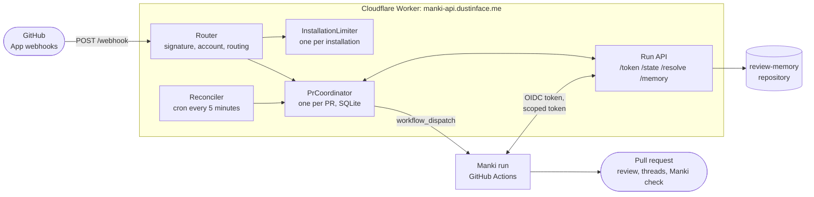
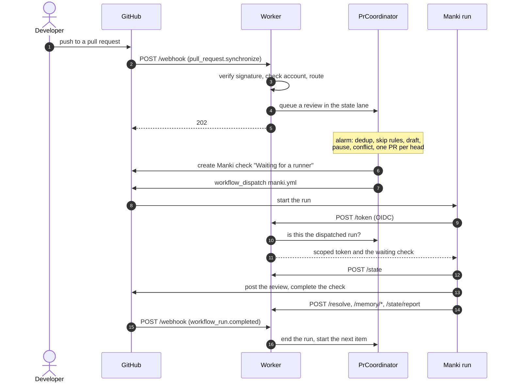

<div align="center">

# manki-token-service

**The Cloudflare Worker behind [Manki](https://github.com/manki-review/manki)'s GitHub App.**

It schedules every review from the App's webhooks, hands each Manki run a token scoped to its own repository,<br>
and keeps the state of every pull request, so the runs themselves hold almost no power.

[](https://github.com/manki-review/token-service/actions/workflows/ci.yml)
[](https://github.com/manki-review/token-service/actions/workflows/deploy.yml)
[](https://github.com/manki-review/token-service/actions/workflows/log-watch.yml)
<br>
[](https://developers.cloudflare.com/workers/)
[](https://developers.cloudflare.com/durable-objects/)
[](https://www.typescriptlang.org/)

`https://manki-api.dustinface.me`

[What it does](#what-it-does) · [Architecture](#architecture) · [Life of a review](#life-of-a-review) · [Endpoints](#endpoints) · [Security model](#security-model) · [Operations](#operations) · [Development](#development)

</div>

---

## What it does

| | Responsibility | In one sentence | Reference |
|---|---|---|---|
| 1 | **Review scheduling** | Verifies the App's webhooks, queues work per pull request, merges repeated pushes into one review and starts the Manki workflow with `workflow_dispatch`. | [coordinator](docs/coordinator.md) |
| 2 | **Decisions without a run** | Answers `@manki help`, checks write access, and applies skip rules, drafts, pauses, base conflicts and one review per head commit, all without spending a runner. | [coordinator](docs/coordinator.md#decisions-without-a-run) |
| 3 | **Waiting check** | Puts a queued `Manki` check on the commit the moment a review is dispatched, and makes sure every check it created ends. | [waiting check](docs/waiting-check.md) |
| 4 | **Settings boxes** | Applies the ticks in Manki's progress comment: Pause, Review again, Deeper review, Cancel and Review this draft. | [settings boxes](docs/settings-boxes.md) |
| 5 | **Tokens** | Gives the run a coordinator dispatched a GitHub App token for its own repository only, with the fewest permissions and no push. | [tokens](docs/tokens.md) |
| 6 | **PR state** | Keeps what is queued and running, the last reviewed commit, the last approval and the pause of each PR, so Manki never parses its own comments. | [PR state](docs/state.md) |
| 7 | **Thread resolution** | Resolves and reopens Manki's review threads for the run, which GitHub only allows with `contents: write`. | [thread resolution](docs/resolve.md) |
| 8 | **Review memory** | Reads and writes each public repository's learnings in the central `review-memory` repository. No memory token leaves the Worker. | [memory](docs/memory.md) |
| 9 | **Reconciler** | Every 5 minutes, redelivers failed webhooks and catches up pull requests whose head never got a review. | [reconciler](docs/reconciler.md) |
| 10 | **Log watch** | Every hour, scans the Worker's logs for warning signs and keeps one GitHub issue open while they last. | [operations](docs/operations.md#log-watch) |

## Architecture



The coordinator also writes to the pull request itself where no run is needed: the waiting check, skip and conflict notes, reactions and `@manki help` answers. The reconciler talks to GitHub too, to redeliver failed webhooks and find pull requests that missed a review.

Three [Durable Objects](https://developers.cloudflare.com/durable-objects/) hold all state:

| Durable Object | One per | Holds |
|---|---|---|
| `PrCoordinator` | Pull request or issue (`<repository id>:<number>`) | Seen deliveries, the work queue of each lane, active runs, PR state and settings |
| `InstallationLimiter` | App installation | The hourly count of stored deliveries from people without write access |
| `Reconciler` | Whole Worker (singleton) | The opt-in registry and the webhook redelivery scan position |

## Life of a review



## Endpoints

Every endpoint except `/webhook` takes the run's [GitHub OIDC token](https://docs.github.com/en/actions/security-for-github-actions/security-hardening-your-deployments/about-security-hardening-with-openid-connect) as the bearer token and answers only the run a coordinator dispatched.

| Endpoint | Called by | Does | Reference |
|---|---|---|---|
| `POST /webhook` | GitHub App | Receives deliveries, checked by HMAC signature | [coordinator](docs/coordinator.md#receiving-deliveries) |
| `POST /token` | Manki run | Mints a scoped installation token | [tokens](docs/tokens.md) |
| `POST /state` | Manki run | Reads the PR's queue, active runs, last review, approval, pause and settings | [PR state](docs/state.md) |
| `POST /state/report` | The PR's active run | Records the reviewed commit, an approval or a pause | [PR state](docs/state.md) |
| `POST /resolve` | Manki run | Resolves or reopens one of Manki's threads | [thread resolution](docs/resolve.md) |
| `POST /memory/read` | Run of a public repository | Reads the repository's and the global memory files | [memory](docs/memory.md) |
| `POST /memory/write` | Run of a public repository | Replaces one memory file, guarded by its blob sha | [memory](docs/memory.md) |
| `POST /memory/append` | Run of a public repository | Appends lines to the fix-rate metrics | [memory](docs/memory.md) |

## Security model

The Worker holds the App's private key, so the runs never do. What a run can reach:

- **Only the dispatched run gets anything.** A workflow of an allowed repository that the coordinator did not start, such as a `pull_request` or branch workflow, gets `403`.
- **Only its own repository.** Every token covers the one repository in the OIDC `repository_id` claim, and every coordinator is named from that claim, never from the request body.
- **No push.** `contents` is capped at `read` and `actions` at `read`. The writes that need more, such as resolving a thread or writing memory, happen inside the Worker with a token minted for that call alone.
- **Outsiders pay only their own share.** Webhooks are accepted only for listed accounts, deliveries are deduplicated for 7 days, and comments from people without write access are capped per installation.
- **Every token is audited.** Each mint logs one `token_minted` line with its purpose, repository and permissions, never the token. See [audit log](docs/tokens.md#audit-log).

## Operations

| Topic | In short | Reference |
|---|---|---|
| Configuration | Secrets `APP_ID`, `APP_PRIVATE_KEY`, `WEBHOOK_SECRET` (plus optional ones), switches in `wrangler.toml` | [configuration](docs/operations.md#configuration) |
| Deployment | A merge to `main` that changes the Worker deploys from GitHub Actions after the owner approves | [deployment](docs/operations.md#deployment) |
| Log watch | Hourly scan of Workers Logs that opens one issue for warning signs | [log watch](docs/operations.md#log-watch) |
| Cost | Runs on the Workers Free plan, with the request budget explained | [cost](docs/operations.md#cost-on-the-workers-free-plan) |

## Development

```sh
npm install
npm run dev        # local dev server
npm run typecheck  # type-check the Worker and the tests
npm test           # run the tests
npm run deploy     # deploy by hand, outside the workflow
```

<details>
<summary>Source layout</summary>

| Path | Holds |
|---|---|
| `src/index.ts` | Entry point and routing of requests and the cron |
| `src/webhook.ts`, `src/signature.ts`, `src/routing.ts` | Webhook verification and routing to lanes |
| `src/coordinator.ts`, `src/dispatch.ts`, `src/opt-in.ts` | `PrCoordinator`: queues, dispatch, opt-in |
| `src/limiter.ts` | `InstallationLimiter` |
| `src/reconciler.ts` | `Reconciler`: redelivery and catch-up |
| `src/oidc.ts`, `src/run-check.ts`, `src/app-jwt.ts`, `src/github.ts`, `src/permissions.ts` | OIDC checks, the dispatched-run check and token minting |
| `src/state.ts`, `src/resolve.ts`, `src/memory.ts` | `/state`, `/resolve` and `/memory` |
| `scripts/log-watch/` | The hourly log watch |

</details>
